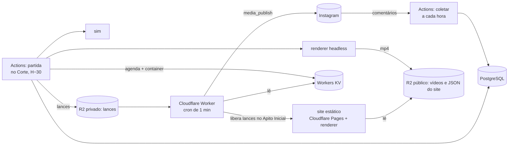
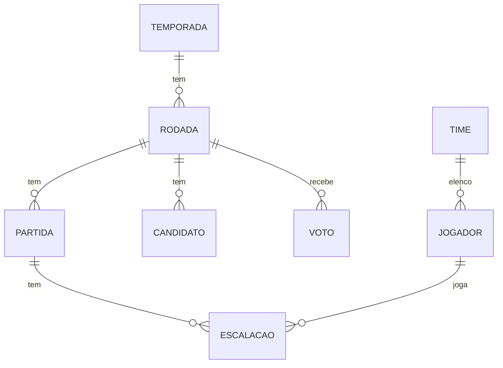

# Arquitetura — Varzeão da Mata

Visão técnica do sistema. Os termos de domínio estão em [`GLOSSARY.md`](../GLOSSARY.md), e as decisões estruturais em [`docs/adr/`](./adr/).

## Visão geral

O **GitHub Actions** (repositório privado) faz o trabalho pesado sem pressa. O **Cloudflare Worker** faz o que precisa de horário exato: liberar os lances no Apito Inicial e publicar os Reels (ADR-0005). Não há servidor sempre ligado.

## O dia de uma Rodada

| Horário | Quem | O quê |
|---|---|---|
| a cada hora (:17) | Actions `coletar` | Lê Comandos, cria Jogadores, registra votos, atualiza o JSON do site |
| 11h30 | Actions `partida` | Fecha a votação do Craque da Rodada anterior. Corte, simulação e render da Partida das 12h (o Reels abre com a revelação do Craque) |
| 12h00 | Worker | Libera os lances; a Partida começa Ao Vivo no site |
| 12h06 | Worker | Publica o Reels da Partida |
| 13h30 · 15h30 · 17h30 | Actions `partida` | O mesmo ciclo para as Partidas das 14h, 16h e 18h |
| 18h10 | Actions `resumo` | Tabela, Candidatos a Craque e render do Resumo; cria o container |
| 19h00 | Worker | Publica o Resumo da Rodada; a votação do Craque começa |

No Mata-mata, as Partidas ocupam os últimos horários: semifinais às 16h e 18h, final às 18h.

## Monorepo (pnpm workspaces)

| Pacote | Responsabilidade |
|---|---|
| `shared` | Tipos de domínio, Times, Clássicos, regras puras (rodízio, tabela, Mata-mata e duração do Ao Vivo) e parser de Comandos |
| `sim` | Motor determinístico: recebe Escalações, seed e fase; devolve lances, placar, pênaltis e Notas. Sem `Math.random` nem relógio |
| `renderer` | Animação 2D (Canvas/Phaser) que reproduz os lances da `sim`. Roda em dois modos: **quadro a quadro**, no Actions, para o vídeo, e **tempo de relógio**, no site, para Ao Vivo e Replay |
| `worker` (Actions) | Jobs `coletar`, `partida` e `resumo`: banco, Graph API, Playwright, ffmpeg, Gemini TTS (ADR-0009), R2 e KV |
| `edge` (Cloudflare Worker) | Cron de 1 minuto que lê a agenda e publica Reels; `GET /partidas/:id`, que só responde depois do Apito Inicial; `GET /dados/*` para o site |
| `site` | Site estático (Cloudflare Pages): Rodada, jogos, tabela, Times e elencos, ranking e Card dos Jogadores, comparação, Escalações, Ao Vivo e Replay |

## Modelo de dados

- **temporada**: numero, status (PRE_TEMPORADA, EM_ANDAMENTO, ENCERRADA), inicio.
- **time**: id (CAP, ONC, …), nome, apelidos[] (usados pelo parser), cores.
- **jogador**: `ig_user_id` (único, chave estável), `username` (atualizado a cada comentário), time_id, posicao, ovr, banido, inscrito_em.
- **comando**: `ig_comment_id` (único, garante idempotência), ig_media_id, ig_user_id, texto, tipo (INSCRICAO, VOTO, INVALIDO), resultado.
- **rodada**: temporada_id, numero, fase (LIGA, MATA_MATA), data, resumo_status (PENDENTE → RENDERIZADO → AGENDADO → PUBLICADO), resumo_ig_media_id.
- **partida**: rodada_id, mandante_id, visitante_id, **apito_inicial**, vantagem_do_empate, **status** (PENDENTE → ESCALADA → SIMULADA → RENDERIZADA → AGENDADA → PUBLICADA), **seed**, **versao_sim**, gols, penaltis, lances (jsonb), video_url, ig_container_id, ig_media_id.
- **escalacao**: partida_id, time_id, lugar (0–6, na ordem GOL, ZAG, ZAG, MEI, MEI, ATA, ATA), jogador_id (nulo = Jogador da Base), posicao, nota, ovr_antes, ovr_depois.
- **candidato**: rodada_id, jogador_id, nota.
- **voto**: rodada_id, ig_user_id, jogador_id; único por (rodada_id, ig_user_id), e o último voto antes do fechamento vale.
- **config**: token do Instagram e data de expiração (espelhados no Workers KV para o Worker).

## Job `coletar` (a cada hora, minuto :17)

0. Renova o token do Instagram se ele tiver mais de 7 dias e leva para o banco o que a borda já publicou.
1. Lista os posts dos últimos 3 dias e busca os comentários via `/{media-id}/comments` (campos `id`, `text`, `timestamp`, `from{id,username}`), do mais antigo ao mais novo.
2. Grava cada comentário em `comando`; um `ig_comment_id` repetido é ignorado.
3. Normaliza o texto (maiúsculas, acentos, emojis) e interpreta:
   - `ENTRO <time|apelido> <posição|sinônimo>` cria o Jogador com OVR sorteado, respeitando o limite de equilíbrio entre Times.
   - `CRAQUE @fulano` registra o voto, apenas em Candidatos a Craque da Rodada anterior.
4. Aplica o filtro de @ e texto ofensivo; banidos são ignorados.
5. Exporta o JSON público do site para o R2 (`dados/liga.json`, `dados/jogadores.json`, `dados/partidas/<id>.json`). Escalações aparecem a partir do Corte; o lance a lance, a partir do Apito; placar, tabela e Card, só quando o Ao Vivo termina.

## Job `partida` (no Corte, 30 min antes de cada Apito Inicial)

Cada etapa só roda se o status da Partida ainda não passou dela; reexecutar retoma de onde parou. O orçamento é de 36 minutos até o Worker publicar o Reels.

1. **Coletar e escalar** (→ ESCALADA): coleta final; monta as duas Escalações (rodízio priorizando quem não jogou, Craque anterior garantido, Base completando vagas).

### Regras do worker (valores iniciais, em `packages/worker/src/regras.ts`)

- **OVR inicial**: sorteado entre 60 e 70 na Inscrição, de forma determinística pelo id do comentário.
- **Jogador da Base**: OVR 55; não ganha nem perde OVR.
- **Equilíbrio entre Times**: um Time não aceita Inscrição se o Elenco já tem 5 Jogadores a mais que o menor Elenco (resultado `TIME_CHEIO`).
- **Rodízio**, por Posição: Craque da Rodada anterior; depois quem jogou menos na Temporada; empate, quem jogou há mais tempo (ou nunca); depois quem se inscreveu antes.
- **Comandos**: `ENTRO` aceita Time e Posição em qualquer ordem, com apelidos, sinônimos e palavras de ligação ("entro na onça de goleira"). Comentário que marca alguém (`@`) depois do ENTRO não inscreve ninguém. `CRAQUE @fulano` vale só para Candidatos da Rodada em votação, e o último voto de cada @ é o que conta.
- **@ ofensivo**: a lista de trechos bloqueados fica em `config` (chave `bloqueio`), editável sem deploy.
2. **Simular** (→ SIMULADA): sorteia e salva o seed, roda a `sim`, grava lances, Notas e OVRs novos. Os lances vão para o **R2 privado**.
3. **Renderizar** (→ RENDERIZADA):
   - O roteiro sai de templates por tipo de evento e por bordão de Time, com variações sorteadas pelo seed.
   - O Gemini TTS (voz Lumi, ADR-0009) gera a narração do Locutor da Liga. A voz fala Posição e Time, e o @ aparece só na tela.
   - O Playwright abre o `renderer` em modo quadro a quadro e salva PNGs, com texto animado sincronizado à narração.
   - O ffmpeg mistura narração, hino royalty-free e efeitos (torcida, apito) e monta o MP4 1080×1920, que sobe para o R2 público.
4. **Agendar** (→ AGENDADA): cria o container `REELS` com `video_url`, espera `status_code = FINISHED` e grava no KV `{partidaId, apitoInicial, publicarEm: apito + 6 min, containerId}`.

## Job `resumo` (18h10)

Calcula tabela e Candidatos a Craque, renderiza o Resumo da Rodada (placares, tabela, Novos Contratados, 5 Candidatos, chamada "comente ENTRO / CRAQUE"), cria o container e agenda no KV para as 19h.

## Worker `edge` (Cloudflare)

- **Cron a cada minuto**: lê só a chave `agenda-proxima` (o KV grátis tem 1.000 listagens por dia). Quando ela vence, lista a agenda e, para cada item vencido e não publicado, confere o container: `FINISHED` → `media_publish`; `PUBLISHED` → só marca (uma execução anterior caiu depois de publicar). Marca `publicadoEm` e `mediaId` no KV e reprograma a `agenda-proxima`. O `coletar` seguinte leva isso para o banco. Falhas ficam no item e são tentadas de novo a cada minuto, até 10 vezes.
- **`GET /partidas/:id`**: a Partida completa do R2 privado. Antes do Apito Inicial responde `425 Too Early` com o horário e `Retry-After`. Depois, entrega com cache longo.
- **`GET /dados/*`**: os JSON do site, lidos do R2 público, com CORS (o site fica no Pages, em outro domínio).
- Horários do cron são UTC. Brasília é UTC−3, sem horário de verão.

## Site (Ao Vivo e Replay)

- **Ao Vivo**: no Apito Inicial, o site busca os lances e posiciona o `renderer` em `(agora − apito) × 15`. Quem entra no meio pega o jogo em andamento, com placar correto. A Partida dura cerca de 6 minutos.
- **Replay**: qualquer Partida terminada é reproduzida do início, com controles de pausa e velocidade.
- **Antes do Apito**: contagem regressiva e as Escalações, sem resultado.

## Segredos

Lista completa e passo a passo em [implantacao.md](implantacao.md).

- **GitHub Actions** (secrets): `DATABASE_URL`, `IG_USER_ID`, `IG_ACCESS_TOKEN`, `GEMINI_API_KEY`, `CF_ACCOUNT_ID`, `CF_API_TOKEN` (KV), `CF_KV_NAMESPACE_ID`, `R2_ACCESS_KEY_ID`, `R2_SECRET_ACCESS_KEY`, `CF_DEPLOY_TOKEN` (Pages).
- **Worker**: vínculos com o KV e os dois buckets. O token do Instagram é lido do KV (`ig/token`), que o `coletar` atualiza ao renová-lo a cada 7 dias; o token renovado também fica no banco (`config.ig_token`).

Falhas do Actions chegam pelo e-mail padrão do GitHub e podem ser reexecutadas pela aba Actions.

## Orçamento de minutos do Actions (estimativa)

Cerca de 720 execuções curtas do `coletar` (~720 min), 4 jobs `partida` de 10–12 min por dia (~1.400 min) e 1 `resumo` de ~10 min por dia (~300 min) somam **~2.400 min/mês, acima dos 2.000 gratuitos** de repositório privado.

Para caber, há três saídas: deixar o repositório **público** (Actions sem limite de minutos nos runners padrão; o código não tem segredos, eles ficam nos Secrets), pausar o `coletar` fora da Temporada e de madrugada, ou rodar o render num runner próprio.
