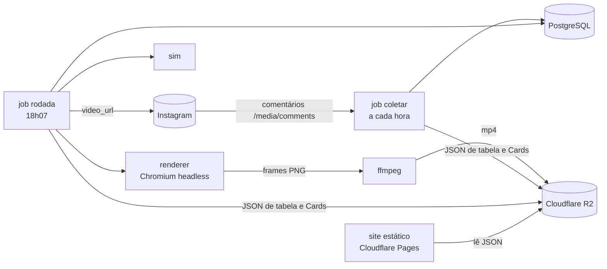
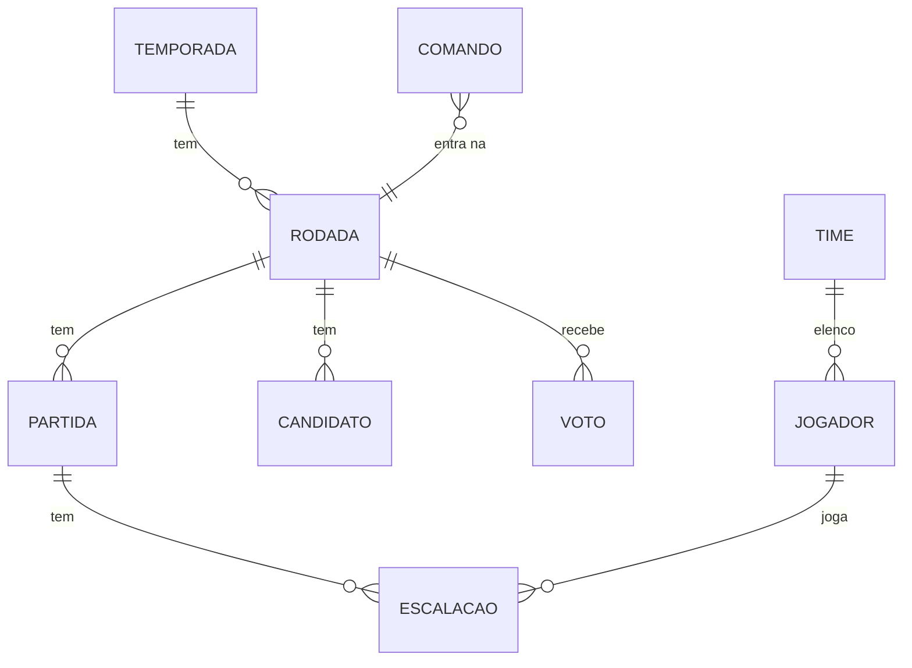

# Arquitetura — Liga dos Seguidores

Visão técnica do sistema. Os termos de domínio estão em [`GLOSSARY.md`](../GLOSSARY.md), e as decisões estruturais em [`docs/adr/`](./adr/).

## Visão geral

Tudo roda em **GitHub Actions** agendado, num repositório privado. Não há servidor sempre ligado.

## Monorepo (pnpm workspaces)

| Pacote | Responsabilidade |
|---|---|
| `shared` | Tipos de domínio, regras puras (rodízio, tabela, Vantagem do Empate) e parser de Comandos |
| `sim` | Motor determinístico: recebe Escalações, seed e versão; devolve eventos, placar, pênaltis e Notas da Partida. Sem `Math.random` nem relógio |
| `renderer` | Página web (Canvas/Phaser) que reproduz os eventos da `sim` quadro a quadro, em passo fixo |
| `worker` | Jobs `coletar` e `rodada`: banco, Graph API, Playwright, ffmpeg, R2 e token |
| `site` | Site estático com tabela, artilharia e busca do Card pelo @ |

## Modelo de dados

- **temporada**: numero, status (PRE_TEMPORADA, EM_ANDAMENTO, ENCERRADA), inicio.
- **time**: nome, slug, apelidos[] (usados pelo parser), cores.
- **jogador**: `ig_user_id` (único, chave estável), `username` (atualizado a cada comentário), time_id, posicao, ovr, banido, inscrito_em.
- **comando**: `ig_comment_id` (único, garante idempotência na coleta), ig_media_id, ig_user_id, texto, tipo (INSCRICAO, VOTO, INVALIDO), resultado.
- **rodada**: temporada_id, numero, fase (LIGA, SEMI, FINAL), data, **status** (PENDENTE → COLETADA → SIMULADA → RENDERIZADA → PUBLICADA), video_url, ig_media_id.
- **partida**: rodada_id, mandante_id, visitante_id, **seed**, **versao_sim**, gols, penaltis, eventos (jsonb).
- **escalacao**: partida_id, time_id, jogador_id (nulo = Jogador da Base), posicao, nota, ovr_antes, ovr_depois.
- **candidato**: rodada_id, jogador_id, nota (os 5 maiores).
- **voto**: rodada_id, ig_user_id, jogador_id; único por (rodada_id, ig_user_id), e o último voto antes do Corte vale.
- **config**: token do Instagram e data de expiração.

## Job `coletar` (a cada hora, minuto :17)

1. Lista os Reels da Liga ainda abertos e busca comentários novos via `/{media-id}/comments` (campos `id`, `text`, `from`, `timestamp`).
2. Grava cada comentário em `comando`; um `ig_comment_id` repetido é ignorado.
3. Normaliza o texto (maiúsculas, acentos, emojis) e interpreta:
   - `ENTRO <time|apelido> <posição|sinônimo>` cria o Jogador com OVR sorteado, respeitando o limite de equilíbrio entre Times.
   - `CRAQUE @fulano` registra o voto, apenas em Candidatos a Craque da Rodada anterior.
4. Aplica o filtro de @ e texto ofensivo; banidos são ignorados.
5. Exporta o JSON do site (tabela e Cards) para o R2, então o Card aparece em até 1 hora.

## Job `rodada` (diário, 18h07 America/Sao_Paulo)

Cada etapa só roda se o status da Rodada ainda não passou dela; reexecutar retoma de onde parou.

1. **Coletar** (→ COLETADA): coleta final até o Corte das 18h e apuração do Craque da Rodada anterior.
2. **Simular** (→ SIMULADA): monta as Escalações (rodízio priorizando quem não jogou, Craque anterior garantido, Base completando vagas), sorteia e salva o seed, roda a `sim`, grava eventos, Notas, Candidatos a Craque e OVRs novos.
3. **Renderizar** (→ RENDERIZADA):
   - O roteiro sai de templates por tipo de evento e por bordão de Time, com as variações sorteadas pelo seed da Rodada.
   - O Azure Speech gera a narração do Locutor da Liga. A voz fala Posição e Time ("gol do atacante da Capivara!"), e o @ aparece só na tela.
   - O Playwright abre o `renderer`, avança quadro a quadro e salva PNGs, com texto animado sincronizado às marcações de tempo da narração.
   - O ffmpeg mistura narração, hino royalty-free e efeitos (torcida, apito) e monta o MP4 1080×1920, que sobe para o R2.
4. **Publicar** (→ PUBLICADA): cria o container `REELS` com `video_url`, consulta `status_code` até `FINISHED`, chama `media_publish` e guarda o `ig_media_id`.
5. **Fechamento**: exporta o JSON do site e renova o token se faltarem menos de 15 dias para expirar.

Falhas chegam pelo e-mail padrão do GitHub Actions, e o job pode ser reexecutado manualmente pela aba Actions.

### Roteiro do Reels (30–45 s)

Gancho (2 s) → Novos Contratados → lances das 4 Partidas → placares e tabela → Craque da Rodada anterior revelado → 5 Candidatos a Craque desta Rodada → chamada "comente ENTRO / CRAQUE".

## Segredos (GitHub Actions)

`DATABASE_URL`, `IG_USER_ID`, `IG_APP_SECRET`, `R2_ACCESS_KEY_ID`, `R2_SECRET_ACCESS_KEY`, `R2_BUCKET`, `AZURE_SPEECH_KEY`, `AZURE_SPEECH_REGION`. O token renovado fica no banco, e não no secret, para o job conseguir atualizá-lo sozinho.

## Orçamento de minutos (estimativa)

Cerca de 720 execuções curtas do `coletar` mais cerca de 30 execuções de 10–15 min do `rodada` resultam em ~1.200 min/mês, dentro dos 2.000 min/mês gratuitos de repositório privado.
